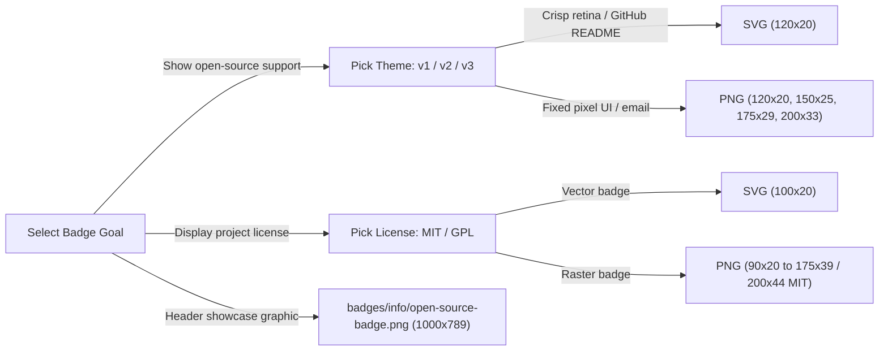

# Open Source & License Badges

Badges to show your support for Open Source and document project licensing cleanly in repository READMEs.

See [Documentation Index](docs/index.md) for guided tutorials, ASD-STE100 procedures, full asset specs, and design notes.

## Quick Gallery

### Open Source Badges (`120x20px` default)

[](https://github.com/jmrenouard/open-source-badges) [](https://github.com/jmrenouard/open-source-badges) [](https://github.com/jmrenouard/open-source-badges)

### License Badges (`100x20px` SVG / `90x20px` PNG)

[](https://opensource.org/licenses/MIT) [](https://www.gnu.org/licenses/gpl-3.0.html)

### Showcase Banner (`1000x789px`)

[](https://github.com/jmrenouard/open-source-badges)

## Badge Selection Flow



## Open Source v1

### SVG (`120x20px`)

[](https://github.com/jmrenouard/open-source-badges)

```markdown
[](https://github.com/jmrenouard/open-source-badges)
```

### PNG (`120x20px`, `150x25px`, `175x29px`, `200x33px`)

Default size (`120x20px`):

[](https://github.com/jmrenouard/open-source-badges)

```markdown
[](https://github.com/jmrenouard/open-source-badges)
```

Size `150x25px`:

[](https://github.com/jmrenouard/open-source-badges)

```markdown
[](https://github.com/jmrenouard/open-source-badges)
```

Size `175x29px`:

[](https://github.com/jmrenouard/open-source-badges)

```markdown
[](https://github.com/jmrenouard/open-source-badges)
```

Size `200x33px`:

[](https://github.com/jmrenouard/open-source-badges)

```markdown
[](https://github.com/jmrenouard/open-source-badges)
```

## Open Source v2

### SVG (`120x20px`)

[](https://github.com/jmrenouard/open-source-badges)

```markdown
[](https://github.com/jmrenouard/open-source-badges)
```

### PNG (`120x20px`, `150x25px`, `175x29px`, `200x33px`)

Default size (`120x20px`):

[](https://github.com/jmrenouard/open-source-badges)

```markdown
[](https://github.com/jmrenouard/open-source-badges)
```

Size `150x25px`:

[](https://github.com/jmrenouard/open-source-badges)

```markdown
[](https://github.com/jmrenouard/open-source-badges)
```

Size `175x29px`:

[](https://github.com/jmrenouard/open-source-badges)

```markdown
[](https://github.com/jmrenouard/open-source-badges)
```

Size `200x33px`:

[](https://github.com/jmrenouard/open-source-badges)

```markdown
[](https://github.com/jmrenouard/open-source-badges)
```

## Open Source v3

### SVG (`120x20px`)

[](https://github.com/jmrenouard/open-source-badges)

```markdown
[](https://github.com/jmrenouard/open-source-badges)
```

### PNG (`120x20px`, `150x25px`, `175x29px`, `200x33px`)

Default size (`120x20px`):

[](https://github.com/jmrenouard/open-source-badges)

```markdown
[](https://github.com/jmrenouard/open-source-badges)
```

Size `150x25px`:

[](https://github.com/jmrenouard/open-source-badges)

```markdown
[](https://github.com/jmrenouard/open-source-badges)
```

Size `175x29px`:

[](https://github.com/jmrenouard/open-source-badges)

```markdown
[](https://github.com/jmrenouard/open-source-badges)
```

Size `200x33px`:

[](https://github.com/jmrenouard/open-source-badges)

```markdown
[](https://github.com/jmrenouard/open-source-badges)
```

## MIT License Badge

### SVG (`100x20px`)

[](https://opensource.org/licenses/MIT)

```markdown
[](https://opensource.org/licenses/MIT)
```

### PNG (`90x20px`, `125x28px`, `150x33px`, `175x39px`, `200x44px`)

Default size (`90x20px`):

[](https://opensource.org/licenses/MIT)

```markdown
[](https://opensource.org/licenses/MIT)
```

Size `125x28px`:

[](https://opensource.org/licenses/MIT)

```markdown
[](https://opensource.org/licenses/MIT)
```

Size `150x33px`:

[](https://opensource.org/licenses/MIT)

```markdown
[](https://opensource.org/licenses/MIT)
```

Size `175x39px`:

[](https://opensource.org/licenses/MIT)

```markdown
[](https://opensource.org/licenses/MIT)
```

Size `200x44px`:

[](https://opensource.org/licenses/MIT)

```markdown
[](https://opensource.org/licenses/MIT)
```

## GPL License Badge

### SVG (`100x20px`)

[](https://www.gnu.org/licenses/gpl-3.0.html)

```markdown
[](https://www.gnu.org/licenses/gpl-3.0.html)
```

### PNG (`90x20px`, `125x28px`, `150x33px`, `175x39px`)

Default size (`90x20px`):

[](https://www.gnu.org/licenses/gpl-3.0.html)

```markdown
[](https://www.gnu.org/licenses/gpl-3.0.html)
```

Size `125x28px`:

[](https://www.gnu.org/licenses/gpl-3.0.html)

```markdown
[](https://www.gnu.org/licenses/gpl-3.0.html)
```

Size `150x33px`:

[](https://www.gnu.org/licenses/gpl-3.0.html)

```markdown
[](https://www.gnu.org/licenses/gpl-3.0.html)
```

Size `175x39px`:

[](https://www.gnu.org/licenses/gpl-3.0.html)

```markdown
[](https://www.gnu.org/licenses/gpl-3.0.html)
```

## Development & License

- Original author: [Maik Ellerbrock](https://github.com/ellerbrock/) ([Frapsoft](https://github.com/frapsoft/))
- Fork maintainer: `jmrenouard/open-source-badges`
- License: [Creative Commons Attribution 4.0 International](https://creativecommons.org/licenses/by/4.0/) (full text in [LICENCE](LICENCE)).
