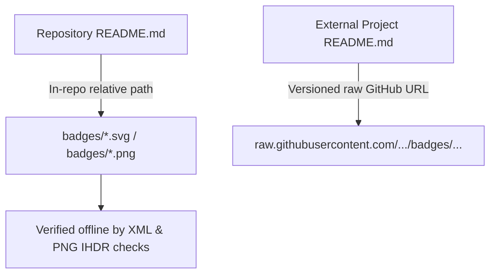

# SVG vs. PNG and Hosting Design

## Format Trade-Offs (SVG vs. Raster PNG)

Each badge theme under `badges/` ships one vector `.svg` file alongside pre-scaled `.png` variants (`120x20` up to `200x44` pixels).

| Criterion | Vector `.svg` | Raster `.png` |
| :--- | :--- | :--- |
| High-DPI / Retina crispness | Scales cleanly at any zoom | Fixed pixel grid; requires matching size file |
| Email / strict Markdown renderers | Some legacy mail clients block SVG | Universally rendered bitmap (`IHDR` validated) |
| Font dependency | Depends on `DejaVu Sans, Verdana, Geneva` glyphs | Pre-rasterized; zero client font lookup |
| Aspect parity | MIT/GPL SVG is `100x20` | Default MIT/GPL PNG is `90x20` |

## Hosting Architecture: Local Assets vs. Legacy CDNs

Historically, `README.md` pointed to `https://badges.frapsoft.com/` and `https://github.frapsoft.com/`. Relying exclusively on unowned external domains couples documentation visibility to external DNS and TLS lifetimes.

Using tracked relative `badges/` paths inside this repository and `raw.githubusercontent.com` URLs for external embeds removes single-domain outage risk while keeping upstream SVG assets unchanged for visual compatibility.

## Upstream Asset Preservation

Four original SVGs (`open-source-v1`, `open-source-v2`, `licence-mit`, `licence-gpl`) include `<g mask="url(#m1)">` referencing a `<linearGradient id="m1">` element and omit `viewBox`. Keeping those XML files untouched preserves bit-for-bit visual fidelity with upstream derivatives while recording exact rendered attributes in the Reference table.

## Related Documentation

- Exact SVG/PNG catalog: [Badge Catalog and Dimensions](../03-reference/badge-catalog-and-dimensions.md)
- Embedding and verification procedure: [Embed and Verify Badges](../02-how-to-guides/embed-and-verify-badges.md)
